# Peramalan Kecepatan Angin Harian Satu Hari ke Depan: Replikasi dan Ekstensi Perbandingan Model Machine Learning

**Studi kasus:** NREL/NLR National Wind Technology Center M2, Boulder, Colorado, 2019–2023
**Paper acuan:** Altork, Y. (2025). *Comparative analysis of machine learning models for wind speed forecasting: Support vector machines, fine tree, and linear regression approaches.* International Journal of Thermofluids, 27, 101217.

---

## Abstrak

Penelitian ini melakukan replikasi ringan Altork (2025) sebagai *sanity check*, lalu memperluasnya menjadi tugas peramalan yang operasional: memprediksi rata-rata kecepatan angin harian pada ketinggian 50 m untuk hari t+1 menggunakan data National Wind Technology Center M2, Boulder, Colorado, periode 2019–2023. Data satu menit dari MIDC diagregasi menjadi 1.826 observasi harian dan 60 observasi bulanan. Replikasi bulanan memakai lima input dan split acak 70/15/15 seperti paper, sedangkan eksperimen utama memakai 16 fitur (delapan lag kecepatan angin, arah angin dalam sin/cos, empat variabel meteorologi, dan dua fitur kalender) dengan split kronologis: latih 2019–2021, validasi 2022, uji 2023. Lima predictor dibandingkan: persistence, Linear Regression, SVR RBF, Fine Tree, dan Random Forest. Pada data uji 2023, seluruh model ML mengalahkan persistence; SVR memberikan RMSE terendah 2,0044 m/s (reduksi 23,73% terhadap persistence 2,6282 m/s), diikuti Random Forest 2,0045 m/s, Linear Regression 2,0271 m/s, dan Fine Tree 2,1515 m/s. Namun R² terbaik hanya 0,0825, jauh di bawah R² 0,97 yang dilaporkan paper. Selisih ini bukan kegagalan implementasi, melainkan konsekuensi dari perubahan protokol: paper melakukan regresi *same-period* pada data bulanan yang telah dihaluskan, sedangkan studi ini meramalkan nilai yang belum teramati pada resolusi harian.

**Kata kunci:** peramalan kecepatan angin, t+1, NWTC M2, SVR, Random Forest, persistence baseline

---

## 1. Pendahuluan

### 1.1 Latar belakang

Kecepatan angin adalah variabel yang menentukan keluaran daya turbin angin dan merupakan salah satu deret waktu meteorologi yang paling sulit diramalkan karena bersifat non-linear, tidak stasioner, dan sangat bergantung pada kondisi atmosfer lokal. Bagi operator pembangkit, kesalahan peramalan satu hari ke depan berdampak langsung pada penjadwalan dan cadangan daya; karena itu evaluasi model peramalan harus dilakukan pada tugas peramalan yang sebenarnya, bukan pada regresi nilai yang sudah teramati.

### 1.2 Paper acuan dan celah penelitian

Altork (2025) membandingkan Support Vector Machine, Fine Tree, dan Linear Regression pada data meteorologi bulanan NWTC M2 periode 2019–2023 (60 observasi). Lima variabel meteorologi dipetakan ke kecepatan angin pada periode yang sama, dengan split acak 70% latih, 15% validasi, dan 15% uji. Hasil yang dilaporkan: Linear Regression terbaik (RMSE 0,29555; R² 0,97), diikuti SVM (RMSE 0,32275; R² 0,96), lalu Fine Tree (RMSE 0,44042; R² 0,93).

Metodologi tersebut adalah regresi *same-period*: tidak ada fitur historis, tidak ada horizon peramalan, dan target adalah nilai yang sudah teramati pada periode yang sama dengan fitur. Nilai R² 0,97 sebagian besar mencerminkan dua hal: penghalusan akibat rata-rata bulanan, dan sifat *same-period* itu sendiri. Paper juga mengakui bahwa rata-rata bulanan menghilangkan variasi jangka pendek dan menyarankan data harian atau per jam, *feature engineering*, serta *ensemble learning* sebagai penelitian lanjutan.

Celah inilah yang diisi penelitian ini: mengevaluasi model yang sama pada tugas yang benar-benar bersifat peramalan, yaitu prediksi hari t+1 dari informasi sampai akhir hari t.

### 1.3 Pertanyaan riset

1. Apakah model yang menang pada data bulanan *same-period* juga menang pada peramalan harian t+1?
2. Apakah Random Forest sebagai model *ensemble* non-linear mengungguli Linear Regression, SVR, dan Fine Tree pada tugas t+1?
3. Fitur apa yang paling berpengaruh pada tugas t+1, dan apakah temperatur masih dominan seperti klaim paper?
4. Seberapa besar penurunan performa ketika tugas diubah dari *same-period regression* menjadi peramalan t+1?

---

## 2. Tinjauan Pustaka

**Support Vector Regression (SVR).** SVR dengan kernel RBF memetakan input ke ruang berdimensi lebih tinggi dan mencari fungsi regresi dengan margin kesalahan (ε) yang masih dapat ditoleransi, dikendalikan oleh parameter C dan γ. SVR sensitif terhadap skala fitur sehingga memerlukan normalisasi.

**Fine Tree.** Pada paper, *Fine Tree* merujuk pada pohon regresi dengan banyak cabang (kedalaman besar, daun kecil). Implementasi di sini memakai `DecisionTreeRegressor` dengan `max_depth` dan `min_samples_leaf` sebagai hyperparameter yang dituning.

**Linear Regression.** Model linear yang meminimalkan jumlah kuadrat residual. Kesederhanaannya membuatnya kuat pada data yang telah dihaluskan (agregat bulanan), tetapi terbatas ketika hubungan antar variabel non-linear.

**Random Forest.** Breiman (2001) memperkenalkan *random forest* sebagai kumpulan pohon keputusan yang dilatih pada sampel *bootstrap* dengan subset fitur acak di setiap pemisahan. Model ini tahan terhadap outlier, menangani interaksi non-linear, dan menyediakan ukuran kepentingan fitur. Altork (2025) sendiri menyebut Random Forest sebagai metode yang terbukti akurat untuk prediksi kondisi cuaca dan menempatkan *ensemble learning* sebagai arah pengembangan.

**Data sirkular.** Arah angin adalah variabel sirkular: 350° dan 10° hanya berjarak 20°, bukan 340°. Fisher (1993) menegaskan bahwa rata-rata linear atas derajat tidak valid; rata-rata harus dihitung secara vektor, `atan2(mean(sin θ), mean(cos θ))`, lalu dienkode sebagai pasangan sin/cos.

**Peramalan deret waktu.** Hyndman & Athanasopoulos (2021) menekankan bahwa evaluasi peramalan memerlukan split kronologis, pembanding baseline naif (*persistence*), dan pemisahan tegas antara data latih, validasi, dan uji. Baseline persistence (`pred(t+1) = y(t)`) adalah standar minimum yang harus dikalahkan agar sebuah model peramalan memiliki nilai tambah.

---

## 3. Data dan Preprocessing

### 3.1 Sumber dan periode

Data berasal dari Measurement and Instrumentation Data Center (MIDC), situs NWTC M2, Boulder, Colorado, dengan resolusi satu menit. Pengunduhan dilakukan per bulan melalui API publik MIDC untuk periode 1 Januari 2019 – 31 Desember 2023 (60 bulan, 1.826 hari teoretis). Data diunduh oleh `scripts/download_data.py` dengan mekanisme *checkpoint* per bulan, penulisan atomik, dan validasi jumlah baris, lalu diagregasi oleh `scripts/preprocess.py`.

### 3.2 Aturan agregasi

- **`MST` adalah HHMM, bukan menit sejak tengah malam.** `MST = 100` berarti 01.00. Kesalahan membaca kolom ini akan menghasilkan timestamp duplikat dan rentang tanggal bergeser; perilaku ini dikunci oleh unit test.
- **Sentinel menjadi `NaN`.** Nilai `-99999`, `-9999`, `-7999`, `-6999`, dan `-999` diperlakukan sebagai data hilang. Selain itu diterapkan batas fisik longgar untuk situs ini (kecepatan angin 0–75 m/s, arah 0–360°, temperatur −90 sampai 60 °C, RH 0–100%, tekanan 300–1.100 mBar, presipitasi 0–500 mm) untuk menangkap glitch sensor yang tidak memakai kode sentinel.
- **Completeness harian minimal 75%** (1.080 dari 1.440 menit valid). Hari di bawah ambang tersebut menghasilkan agregat `NaN`, bukan rata-rata dari beberapa menit data.
- **Presipitasi adalah akumulasi harian yang reset sekitar 00.01.** Nilai pada 00.00 adalah sisa hari sebelumnya, sehingga menit 00.00 dibuang dan diambil nilai maksimum harian — bukan penjumlahan.
- **Arah angin memakai rata-rata vektor**, lalu dienkode sebagai `wind_dir_sin` dan `wind_dir_cos`.
- **Agregat bulanan dihitung langsung dari data satu menit**, bukan dari rata-rata harian.

### 3.3 Kualitas data

Dari 60 bulan yang diproses:

| Temuan | Jumlah |
|---|---|
| Bulan dengan menit duplikat di sumber | 2 bulan (2019-08: 60 menit; 2023-05: 13 menit) |
| Bulan dengan baris kurang dari ekspektasi | 2 bulan (2021-05: 44.625 dari 44.640; 2023-03: 44.631) |
| Menit bertanda `-99999` (tak terdaftar sebagai sentinel di protokol awal) | 11 menit pada 2021-07, di keenam kolom modeling |
| Menit temperatur mustahil (−266,9 sampai −106,1 °C) | 27 menit |
| Total menit sentinel | 19.317 menit (dominan `-7999` pada temperatur: 17.660 menit) |

Blok duplikat pada 2019-08 adalah cacat ekspor sumber: logger mengulang jendela 12.01–13.00 dan kehilangan 14.11–15.10. Menit duplikat diambil kemunculan pertama dan jumlahnya dicatat pada `data_quality.csv`; setelah itu hari tersebut tetap lolos ambang completeness (1.380 dari 1.440 menit = 95,8%).

Hasil agregasi:

| Dataset | Baris | Rentang | Kecepatan angin hilang |
|---|---|---|---|
| `daily.csv` | 1.826 | 2019-01-01 – 2023-12-31 | 0 hari |
| `monthly.csv` | 60 | 2019-01 – 2023-12 | 0 bulan |

Hari dengan temperatur hilang: 19 hari; RH hilang: 2 hari; tekanan, presipitasi, dan arah angin: 0 hari.

### 3.4 Statistik deskriptif dan EDA

| Statistik | Harian | Bulanan |
|---|---|---|
| Mean (m/s) | 4,3967 | 4,4004 |
| Std (m/s) | 2,1418 | 0,7070 |
| Min (m/s) | 0,1890 | 3,4191 |
| Median (m/s) | 3,8217 | — |
| Maks (m/s) | 16,5110 | 6,4758 |

Gambar 1 memperlihatkan deret waktu harian dan Gambar 2 klimatologi per bulan kalender; variabilitas harian (std 2,14 m/s) jauh lebih besar daripada variabilitas bulanan (std 0,71 m/s), yang secara langsung menjelaskan mengapa tugas harian lebih sulit daripada tugas bulanan.

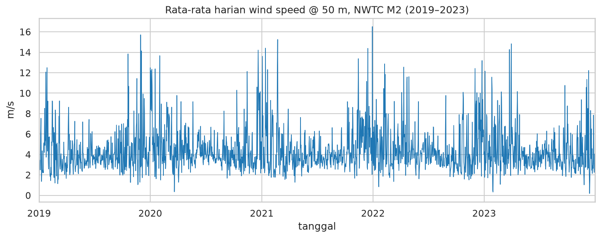
*Gambar 1. Rata-rata harian kecepatan angin 50 m, 2019–2023.*

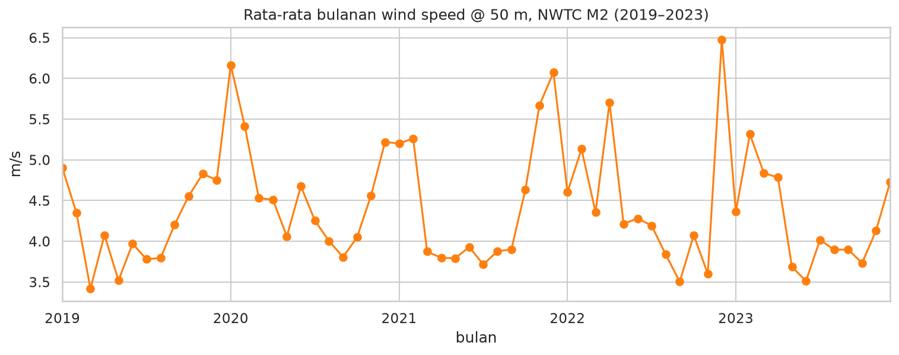
*Gambar 2. Rata-rata bulanan kecepatan angin 50 m, 2019–2023.*

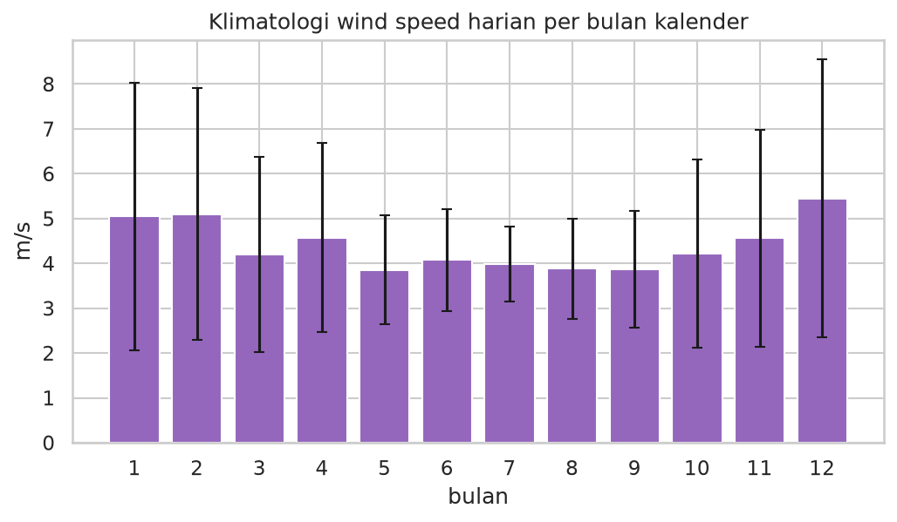
*Gambar 3. Klimatologi kecepatan angin per bulan kalender (mean ± std).*

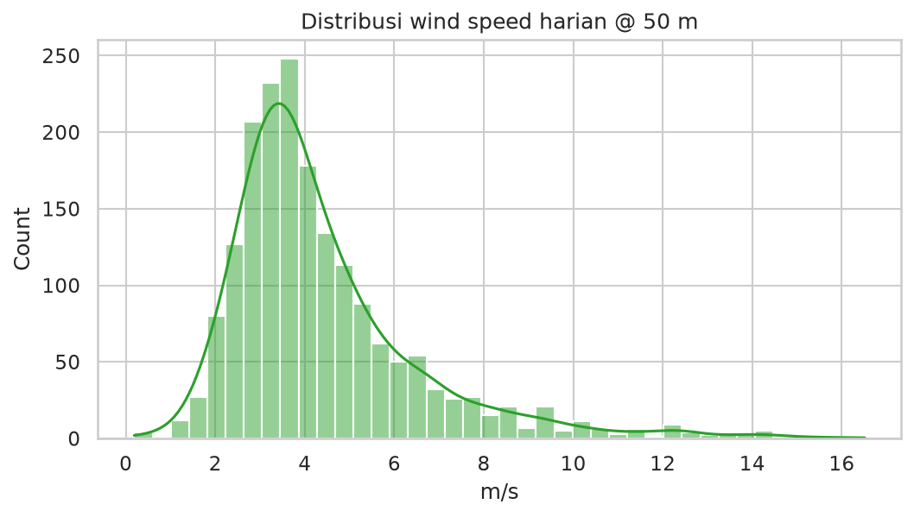
*Gambar 4. Distribusi kecepatan angin harian.*

Korelasi Pearson fitur harian dengan target **pada hari yang sama** (bukan korelasi lintas hari) ditampilkan pada Gambar 5. Nilai tertinggi berasal dari `wind_dir_sin` (−0,436), `relative_humidity` (−0,381), dan `pressure` (−0,306); temperatur hampir tidak berkorelasi linear (−0,018), dan presipitasi mendekati nol (−0,065). Korelasi *same-day* ini tidak dapat dipakai sebagai bukti kekuatan prediktif untuk t+1; analisis kepentingan fitur pada Bagian 6.3 lebih relevan.

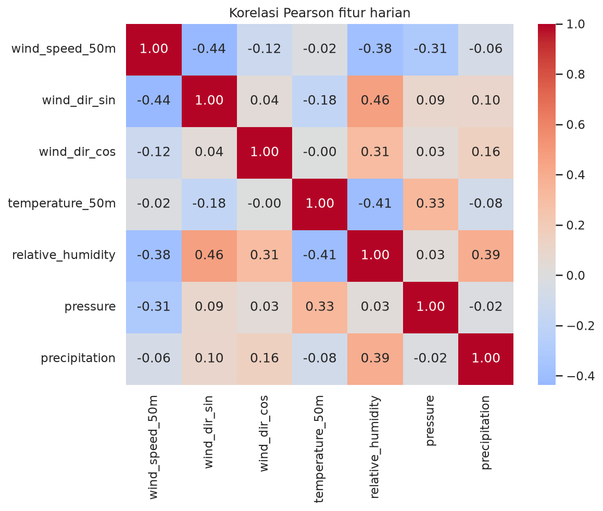
*Gambar 5. Korelasi Pearson antar fitur harian.*

---

## 4. Metodologi

### 4.1 Definisi tugas t+1

Forecast diterbitkan pada akhir hari t (23.59 MST) untuk memprediksi rata-rata kecepatan angin hari t+1. Konsekuensi yang ditegakkan secara eksplisit:

- seluruh fitur meteorologi memakai nilai hari t (dan lag sebelumnya);
- tidak ada observasi meteorologi hari t+1 yang masuk ke fitur;
- fitur kalender memakai *day-of-year* hari target, karena tanggal t+1 sudah diketahui saat forecast terbit;
- target adalah `wind_speed_50m(t+1)`.

Audit kebocoran dijalankan sebagai assertion di notebook: `target` harus identik dengan `wind_speed_50m` pada `target_date`, `lag0` harus identik dengan nilai hari t, dan himpunan fitur harus tidak memuat `target` maupun `target_date`.

### 4.2 Fitur (16)

Delapan lag kecepatan angin (`lag0`–`lag7`), arah angin hari t dalam bentuk `wind_dir_sin` dan `wind_dir_cos`, temperatur, tekanan, RH, presipitasi hari t, serta `doy_sin` dan `doy_cos` untuk hari target.

### 4.3 Pembentukan dataset dan interpolasi

Dataset supervised dibentuk dari 1.826 baris harian. Interpolasi linear dengan batas 2 hari dan hanya di dalam gap (*inside*) diterapkan **hanya** pada fitur non-kecepatan-angin. Target dan `wind_speed_50m` tidak pernah diinterpolasi; baris dengan target atau lag hilang dibuang.

Baris final: **1.808 dari 1.826** (18 hari dibuang: 7 hari pertama karena lag 7 belum tersedia, 1 hari terakhir karena target t+1 tidak ada, dan 10 hari yang fiturnya masih kosong setelah interpolasi).

### 4.4 Split kronologis

| Split | Periode target | Jumlah baris |
|---|---|---|
| Latih | 2019-01-09 – 2021-12-31 | 1.078 |
| Validasi | 2022-01-01 – 2022-12-31 | 365 |
| Uji | 2023-01-01 – 2023-12-31 | 365 |

Tidak ada shuffling. Scaler (Min-Max ke [−1, 1]) hanya di-fit pada data latih; model final memakai pipeline baru yang di-fit ulang pada latih+validasi.

### 4.5 Model dan tuning

| Model | Implementasi | Scaling | Hyperparameter |
|---|---|---|---|
| Persistence | `pred(t+1) = y(t)` | tidak | — |
| Linear Regression | `LinearRegression` | ya | — |
| SVR | `SVR(kernel="rbf")` | ya | C ∈ {0,1; 1; 10; 100}, γ ∈ {scale, 0,01; 0,1}, ε ∈ {0,01; 0,1; 0,5} |
| Fine Tree | `DecisionTreeRegressor` | tidak | `max_depth` ∈ {None, 5, 10, 20}, `min_samples_leaf` ∈ {1, 2, 4, 8} |
| Random Forest | `RandomForestRegressor` | tidak | `n_estimators` = 300, `max_depth` ∈ {None, 10, 20}, `min_samples_leaf` ∈ {1, 2, 4}, `max_features` ∈ {sqrt, 1.0} |

Tuning memakai `TimeSeriesSplit(n_splits=3)` di dalam data latih dengan metrik `neg_root_mean_squared_error`. Konfigurasi terbaik dievaluasi pada validasi, lalu model final di-refit pada latih+validasi dan dievaluasi satu kali pada uji 2023.

### 4.6 Metrik

RMSE, MSE, MAE, dan R². Perbandingan terhadap persistence dilaporkan sebagai reduksi relatif: `(RMSE_persistence − RMSE_model) / RMSE_persistence × 100%`.

### 4.7 Sanity check replikasi

Untuk replikasi paper, dataset bulanan (60 observasi) memakai lima input seperti paper — tekanan, temperatur, arah angin **dalam derajat sebagai satu fitur**, RH, dan presipitasi — dengan split acak 70/15/15 (`random_state=42`) menghasilkan 42/9/9 observasi, serta normalisasi Min-Max yang di-fit pada latih. Split acak **disengaja** pada bagian ini untuk meniru paper; aturan split kronologis hanya berlaku pada eksperimen utama.

---

## 5. Hasil Sanity Check Replikasi

| Model | RMSE | MSE | MAE | R² |
|---|---|---|---|---|
| Linear Regression | 0,4923 | 0,2424 | 0,3380 | 0,4819 |
| Fine Tree | 0,5156 | 0,2658 | 0,4189 | 0,4318 |
| SVR | 0,5372 | 0,2886 | 0,3754 | 0,3831 |

**Angka paper (bukan hasil studi ini, hanya pembanding):** Linear Regression RMSE 0,29555 / MSE 0,087352 / MAE 0,18061 / R² 0,97; SVM RMSE 0,32275 / R² 0,96; Fine Tree RMSE 0,44042 / R² 0,93.

Pipeline berjalan dan urutan model sebagian konsisten: Linear Regression tetap yang terbaik, sebagaimana pada paper. Namun tiga perbedaan perlu dicatat jujur:

1. **R² jauh lebih rendah** (0,4819 versus 0,97). Angka paper tidak dapat direproduksi dengan data dan protokol yang tersedia.
2. **Urutan SVR dan Fine Tree terbalik.** Pada studi ini SVR justru terburuk (0,5372) sedangkan Fine Tree di tengah (0,5156); pada paper SVR (0,32275) lebih baik daripada Fine Tree (0,44042).
3. **RMSE lebih besar** untuk semua model (0,49–0,54 versus 0,30–0,44).

Penyebab yang paling mungkin: paper tidak merinci hyperparameter, mekanisme split, dan detail agregasi; ukuran uji hanya 9 observasi sehingga R² sangat tidak stabil (standar deviasi target uji 0,7255 m/s); serta kemungkinan perbedaan periode atau cara pengambilan data. Karena itu hasil ini diposisikan sebagai *sanity check* alur data dan modeling, bukan sebagai replikasi angka.

---

## 6. Hasil Peramalan t+1

### 6.1 Metrik pada test 2023

| Model | RMSE | MSE | MAE | R² | RMSE reduction vs persistence (%) | MAE reduction vs persistence (%) |
|---|---|---|---|---|---|---|
| SVR | 2,0044 | 4,0177 | 1,3525 | 0,0825 | 23,7341 | 24,9168 |
| Random Forest | 2,0045 | 4,0180 | 1,4171 | 0,0824 | 23,7311 | 21,3300 |
| Linear Regression | 2,0271 | 4,1092 | 1,4401 | 0,0616 | 22,8702 | 20,0523 |
| Fine Tree | 2,1515 | 4,6288 | 1,5357 | −0,0570 | 18,1394 | 14,7465 |
| Persistence | 2,6282 | 6,9074 | 1,8013 | −0,5774 | 0,0000 | 0,0000 |

Temuan utama:

- **Semua model ML mengalahkan persistence.** Reduksi RMSE berkisar 18,14%–23,73%.
- **SVR dan Random Forest praktis seri** (RMSE 2,0044 versus 2,0045 m/s; selisih 0,0001 m/s) — perbedaan sebesar ini tidak dapat dianggap bermakna pada 365 observasi.
- **Linear Regression hanya 1,1% di belakang SVR**, menunjukkan bahwa hubungan linear pada fitur lag sudah menjelaskan sebagian besar sinyal yang dapat dipelajari.
- **Fine Tree adalah satu-satunya model dengan R² negatif** (−0,0570), artinya lebih buruk daripada memprediksi rata-rata uji, meskipun masih lebih baik daripada persistence.
- **R² maksimum hanya 0,0825.** Sebagian besar varians harian tidak dapat dijelaskan oleh informasi sampai akhir hari t.

### 6.2 Hyperparameter final

| Model | Konfigurasi terbaik | RMSE validasi 2022 |
|---|---|---|
| SVR | C = 1, ε = 0,01, γ = scale | 2,0187 |
| Fine Tree | `max_depth` = 5, `min_samples_leaf` = 8 | 2,0325 |
| Random Forest | `n_estimators` = 300, `max_depth` = 20, `min_samples_leaf` = 4, `max_features` = sqrt | 1,9749 |

Random Forest memiliki RMSE validasi terbaik, tetapi keunggulan itu tidak berlanjut ke test: pada 2023 SVR dan Random Forest kembali seri dalam 0,0001 m/s. Ini contoh klasik bahwa peringkat model pada satu tahun validasi tidak otomatis berlaku pada tahun berikutnya.

### 6.3 Feature importance

Permutation importance dihitung pada model ML terbaik (SVR) dengan `n_repeats=30`, `random_state=42`, dan `scoring="neg_root_mean_squared_error"` pada test 2023; impurity importance berasal dari Random Forest.

| Peringkat | Fitur | Permutation importance (mean ± std) | RF impurity | Koefisien LR (setelah scaling) |
|---|---|---|---|---|
| 1 | `wind_dir_sin` | 0,0379 ± 0,0156 | 0,0644 | −0,2162 |
| 2 | `wind_dir_cos` | 0,0311 ± 0,0139 | 0,0684 | −0,2514 |
| 3 | `doy_cos` | 0,0304 ± 0,0162 | 0,1043 | 0,5512 |
| 4 | `temperature_50m` | 0,0258 ± 0,0082 | 0,0613 | 0,3815 |
| 5 | `relative_humidity` | 0,0132 ± 0,0072 | 0,0881 | −0,2292 |
| 6 | `wind_speed_lag4` | 0,0116 ± 0,0044 | 0,0482 | −0,0050 |
| 7 | `pressure` | 0,0112 ± 0,0049 | 0,0861 | −1,0338 |
| 8 | `wind_speed_lag0` | 0,0080 ± 0,0106 | 0,1283 | 1,6058 |

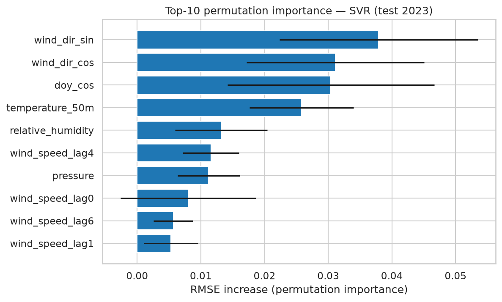
*Gambar 6. Sepuluh fitur teratas menurut permutation importance pada model ML terbaik (SVR).*

Catatan interpretasi:

- **Arah angin (sin/cos) adalah fitur paling penting**, bukan temperatur. Ini berbeda dari klaim paper bahwa temperatur dominan.
- **`doy_cos` (musim) berada di peringkat ketiga**, masuk akal karena rezim angin di Boulder sangat musiman.
- **Beberapa lag memiliki permutation importance negatif** (`wind_speed_lag2` −0,0308; `wind_speed_lag7` −0,0051). Nilai negatif muncul karena lag kecepatan angin saling berkorelasi tinggi: ketika satu lag dikocok, model masih dapat memakai lag lain, sehingga pengocokan justru tampak menurunkan error. Karena itu peringkat individual lag tidak boleh dibaca sebagai "lag ini tidak berguna"; yang dapat disimpulkan adalah lag secara keseluruhan memberi kontribusi lebih kecil daripada arah angin dan musim.
- **Koefisien Linear Regression hanya bermakna setelah scaling** Min-Max ke [−1, 1]; besarnya koefisien tidak dapat dibandingkan langsung dengan besaran fisik variabel asli.

### 6.4 Error per musim

| Musim | Model | RMSE | MAE | n |
|---|---|---|---|---|
| DJF | SVR | 2,7292 | 2,1661 | 90 |
| DJF | Persistence | 3,6818 | 2,7921 | 90 |
| MAM | SVR | 2,2762 | 1,4382 | 92 |
| MAM | Persistence | 2,7714 | 1,8608 | 92 |
| JJA | SVR | 0,9051 | 0,6693 | 92 |
| JJA | Persistence | 1,2220 | 0,9702 | 92 |
| SON | SVR | 1,6378 | 1,1519 | 91 |
| SON | Persistence | 2,2415 | 1,6016 | 91 |

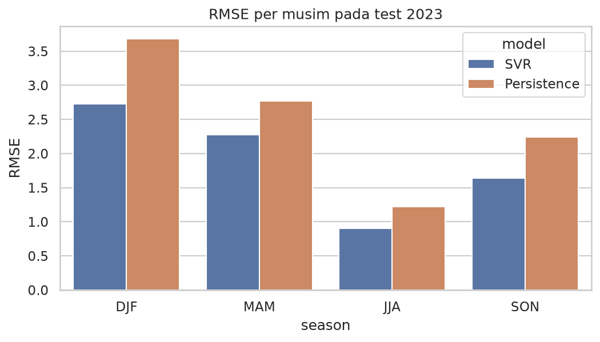
*Gambar 7. RMSE per musim pada test 2023, model terbaik versus persistence.*

Musim dingin (DJF) adalah periode tersulit (RMSE 2,7292 m/s) dan musim panas (JJA) yang termudah (0,9051 m/s). Pola ini konsisten dengan variabilitas angin yang lebih besar pada musim dingin. Keunggulan SVR atas persistence tetap ada di keempat musim, dengan selisih terbesar pada DJF (0,9526 m/s) dan terkecil pada JJA (0,3169 m/s).

### 6.5 Error per level kecepatan angin

| Level | Model | RMSE | MAE | n |
|---|---|---|---|---|
| Rendah | SVR | 1,5086 | 1,2375 | 122 |
| Rendah | Persistence | 2,2903 | 1,5718 | 122 |
| Sedang | SVR | 0,7775 | 0,5842 | 121 |
| Sedang | Persistence | 1,6524 | 1,1303 | 121 |
| Tinggi | SVR | 3,0240 | 2,2295 | 122 |
| Tinggi | Persistence | 3,5654 | 2,6964 | 122 |

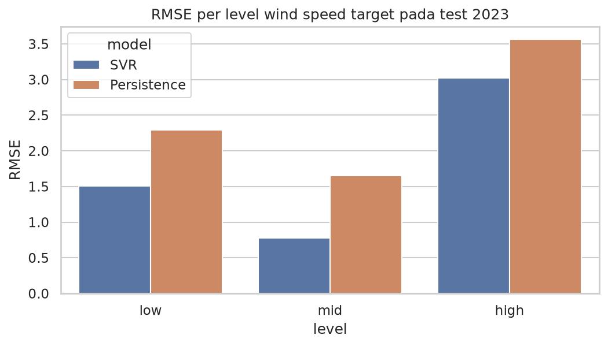
*Gambar 8. RMSE per tertile kecepatan angin target.*

Error terbesar terjadi pada tertile kecepatan angin tinggi (RMSE 3,0240 m/s). Ini adalah kelemahan yang penting secara operasional: justru pada kondisi angin kencang — saat daya yang dibangkitkan paling besar — model paling tidak akurat. Pada level rendah dan sedang, model jauh lebih baik daripada persistence (selisih 0,78 m/s dan 0,87 m/s).

### 6.6 Visualisasi prediksi pada test

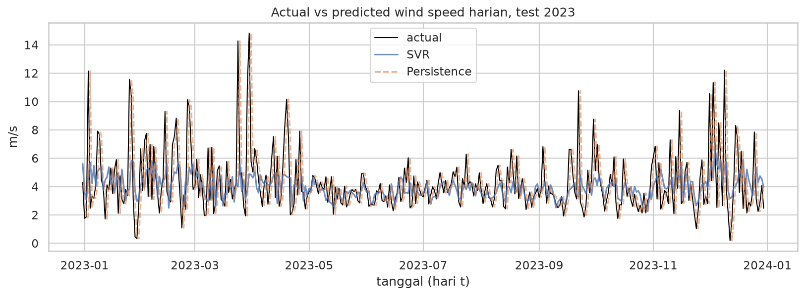
*Gambar 9. Nilai aktual, prediksi SVR, dan persistence sepanjang test 2023.*

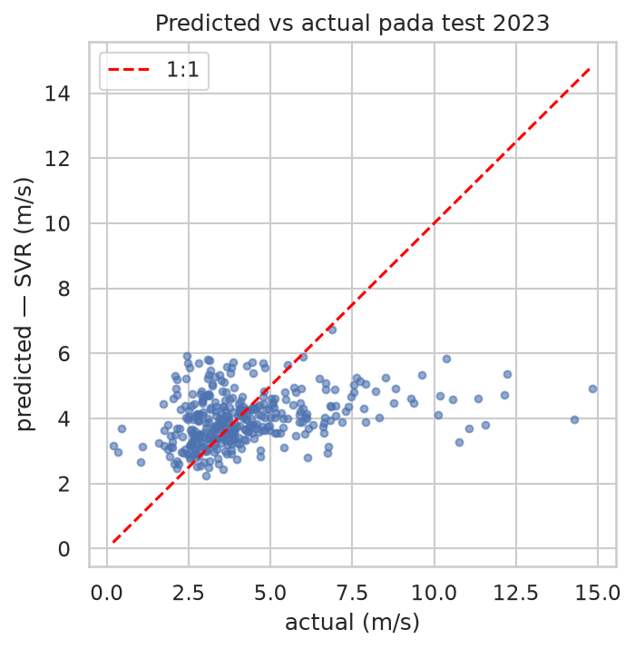
*Gambar 10. Prediksi versus aktual model terbaik dengan garis 1:1.*

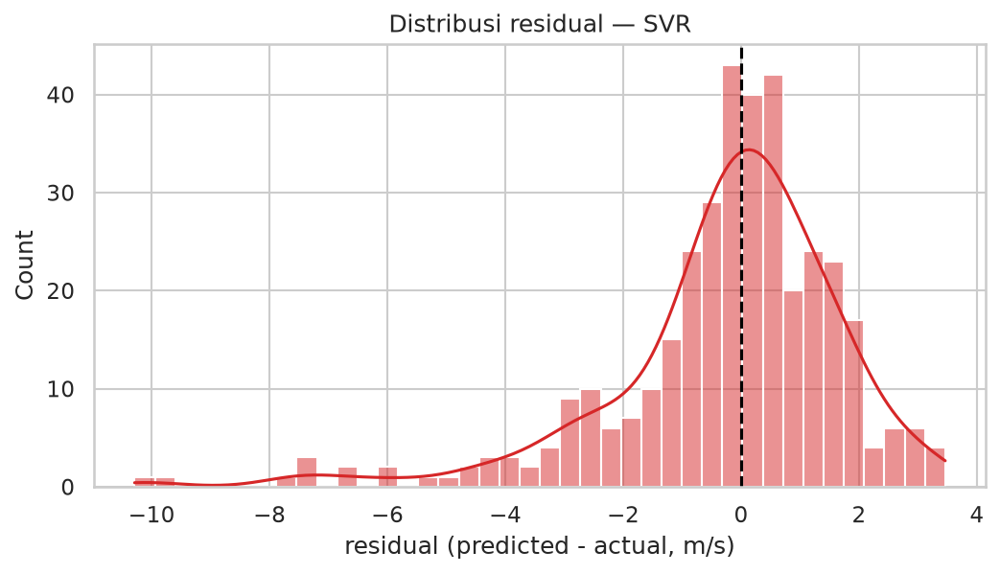
*Gambar 11. Distribusi residual model terbaik (predicted − actual).*

Rata-rata residual adalah −0,2547 m/s dengan standar deviasi 1,9909 m/s: model cenderung sedikit *under-predict*. Sebaran pada Gambar 10 menunjukkan model menyusut ke arah rata-rata — nilai ekstrem tinggi dan rendah tidak terprediksi dengan baik, pola yang khas untuk model regresi pada deret waktu yang bising.

---

## 7. Diskusi

### 7.1 Mengapa R² turun drastis?

R² maksimum pada tugas t+1 adalah 0,0825, sedangkan replikasi bulanan mencapai 0,4819 dan paper melaporkan 0,97. Penurunan ini bukan tanda pipeline rusak, melainkan konsekuensi dari tiga perubahan protokol yang semuanya sudah terverifikasi:

1. **Penghalusan agregasi.** Rata-rata bulanan hampir menghapus varians harian. Standar deviasi target bulanan hanya 0,7070 m/s, sedangkan target harian 2,1418 m/s — tiga kali lipat lebih besar.
2. **Horizon peramalan.** Regresi *same-period* memakai informasi pada periode yang sama dengan target; peramalan t+1 hanya boleh memakai informasi sampai akhir hari t.
3. **Hilangnya lag.** Paper tidak memakai fitur historis, sehingga perbandingannya bukan perbandingan tugas yang sama. Pada studi ini lag justru tersedia dan tetap tidak cukup untuk mencapai R² tinggi.

### 7.2 Apakah model non-linear mengungguli Linear Regression?

Secara statistik, **tidak secara meyakinkan.** SVR (2,0044) dan Random Forest (2,0045) hanya unggul 1,1% atas Linear Regression (2,0271) dalam RMSE, sementara Fine Tree kalah. Dengan 365 observasi uji dan selisih sebesar itu, klaim bahwa model non-linear "lebih baik" tidak dapat dipertahankan. Yang dapat dikatakan: model non-linear memberi nilai tambah yang kecil namun konsisten terhadap persistence, dan Random Forest menyediakan kepentingan fitur yang berguna untuk interpretasi.

### 7.3 Apakah ML mengalahkan persistence?

**Ya, pada semua model dan semua musim.** Ini temuan positif: informasi historis dan meteorologi hari t memang memiliki daya prediksi untuk hari t+1. Namun perlu ditekankan bahwa persistence sendiri sudah merupakan baseline yang kuat (R² −0,5774 berarti lebih buruk daripada rata-rata uji, tetapi RMSE-nya hanya 2,6282 m/s), dan keunggulan 23,73% masih menyisakan error 2,0044 m/s — sekitar 46% dari rata-rata kecepatan angin harian (4,3967 m/s). Untuk aplikasi operasional, error sebesar ini masih terlalu besar untuk dijadikan dasar penjadwalan tanpa interval ketidakpastian.

### 7.4 Mengapa hasil berbeda dari paper?

Selain alasan pada 7.1, replikasi bulanan juga tidak mereproduksi angka paper (R² 0,4819 versus 0,97; SVR justru terburuk). Paper tidak melaporkan hyperparameter, cara split, maupun detail agregasi, sehingga beberapa langkah harus dipilih sendiri di sini (grid hyperparameter kecil, Min-Max [−1, 1] yang di-fit pada latih saja, agregasi bulanan langsung dari data satu menit). Perbedaan urutan SVR dan Fine Tree juga dapat berasal dari sensitivitas SVR terhadap skala dan pemilihan hyperparameter pada hanya 42 observasi latih. Studi ini tidak menyimpulkan paper salah; yang dikatakan adalah bahwa angka paper dihasilkan oleh protokol *same-period* pada data bulanan dan tidak dapat diperlakukan sebagai tolok ukur kemampuan peramalan.

### 7.5 Implikasi praktis

- Arah angin dan musim lebih informatif daripada temperatur untuk horizon satu hari.
- Model linear sudah mendekati batas kemampuan informasi yang tersedia; menambah kompleksitas model bukan prioritas.
- Error terbesar ada pada angin kencang dan musim dingin, sehingga peningkatan kualitas prakiraan pada kondisi tersebut (misalnya dengan data NWP atau resolusi per jam) lebih bernilai daripada mengganti algoritma.
- Random Forest layak dipertahankan sebagai model interpretatif, meskipun performanya seri dengan SVR.

---

## 8. Keterbatasan

1. **Satu lokasi, lima tahun.** Hasil tidak dapat digeneralisasi ke situs lain atau periode lain; 2023 adalah satu-satunya tahun uji.
2. **Resolusi harian.** Rata-rata harian menghilangkan dinamika intra-hari yang relevan untuk operasi turbin.
3. **Tanpa data prakiraan cuaca (NWP).** Fitur hanya berasal dari observasi masa lalu; model tidak memiliki informasi tentang kondisi sinoptik yang akan datang.
4. **Tanpa interval ketidakpastian.** Semua metrik bersifat titik; tidak ada interval prediksi.
5. **Presipitasi jarang dan hampir selalu nol**, sehingga kontribusinya sulit diukur dan permutation importance-nya mendekati nol (−0,0004).
6. **Asumsi stasioneritas** antar tahun; perubahan rezim angin tidak dimodelkan.
7. **Replikasi bulanan memakai 9 observasi uji**, sehingga R² sangat tidak stabil dan urutan model sensitif terhadap pemilihan sampel.
8. **Cacat data sumber.** 2019-08 kehilangan 60 menit dan menduplikasi 60 menit lain; 2021-05 dan 2023-03 sedikit di bawah jumlah menit ekspektasi; sentinel `-99999` tidak tercantum pada protokol awal dan ditemukan saat audit. Semua penanganan dicatat pada `data_quality.csv`.
9. **Grid tuning terbatas.** `n_estimators` Random Forest difiksasi pada 300 dan pencarian dilakukan pada grid kecil dengan tiga fold; hasil dapat berubah dengan pencarian yang lebih luas.
10. **Permutation importance pada fitur yang saling berkorelasi** membagi kredit antar fitur dan dapat menghasilkan nilai negatif, sehingga peringkat fitur individual perlu dibaca hati-hati.

---

## 9. Kesimpulan

1. **Model yang menang pada data bulanan tidak otomatis menang pada tugas t+1.** Linear Regression menang pada replikasi bulanan (RMSE 0,4923; R² 0,4819), tetapi pada tugas t+1 SVR memberikan RMSE terendah (2,0044 m/s), meskipun selisihnya dari Linear Regression hanya 1,1%.
2. **Random Forest tidak mengungguli model lain secara bermakna.** RMSE-nya 2,0045 m/s, praktis identik dengan SVR, dan unggul hanya dalam RMSE validasi 2022 (1,9749).
3. **Fitur paling berpengaruh adalah arah angin (`wind_dir_sin` 0,0379; `wind_dir_cos` 0,0311) dan musim (`doy_cos` 0,0304), bukan temperatur** (0,0258). Klaim dominasi temperatur pada paper tidak berlaku pada tugas t+1 di lokasi ini.
4. **Performa turun drastis ketika tugas diubah menjadi peramalan t+1:** R² dari 0,4819 (bulanan *same-period*) menjadi 0,0825 (harian t+1). Penurunan ini mencerminkan hilangnya penghalusan dan hilangnya informasi masa depan, bukan kegagalan implementasi.
5. **Semua model ML mengalahkan persistence** (reduksi RMSE 18,14%–23,73%), sehingga informasi historis memiliki nilai prediktif nyata — tetapi error absolut 2,0044 m/s masih terlalu besar untuk keputusan operasional tanpa interval ketidakpastian.

---

## Referensi

Altork, Y. (2025). Comparative analysis of machine learning models for wind speed forecasting: Support vector machines, fine tree, and linear regression approaches. *International Journal of Thermofluids, 27*, 101217. https://doi.org/10.1016/j.ijft.2025.101217

Breiman, L. (2001). Random forests. *Machine Learning, 45*(1), 5–32.

Fisher, N. I. (1993). *Statistical analysis of circular data*. Cambridge University Press.

Hyndman, R. J., & Athanasopoulos, G. (2021). *Forecasting: Principles and practice* (3rd ed.). OTexts.

Jager, D., & Andreas, A. (1996). *NREL National Wind Technology Center (NWTC): M2 Tower; Boulder, Colorado (Data)*. NREL Report No. DA-5500-56489. https://www.osti.gov/biblio/1052222

---

## Lampiran

### A. Konfigurasi model final

Sumber: `results/best_params.json`.

| Model | Hyperparameter | RMSE validasi 2022 |
|---|---|---|
| SVR | `C` = 1, `epsilon` = 0,01, `gamma` = scale | 2,018653675755969 |
| Fine Tree | `max_depth` = 5, `min_samples_leaf` = 8 | 2,032548887802719 |
| Random Forest | `n_estimators` = 300, `max_depth` = 20, `min_samples_leaf` = 4, `max_features` = sqrt | 1,9748501685540825 |

### B. Lingkungan dan reproducibility

| Komponen | Versi |
|---|---|
| Python | 3.14.7 |
| numpy | 2.5.5 |
| pandas | 3.1.1 |
| scikit-learn | 1.9.1 |
| matplotlib | 3.11.2 |
| seaborn | 0.13.2 |

- Seed: `random_state = 42` untuk semua split, model, pencarian hyperparameter, dan permutation importance.
- Split: latih 2019-01-09–2021-12-31 (1.078 baris), validasi 2022 (365), uji 2023 (365).
- Perintah reproduksi: `uv sync`, `uv run python -m scripts.download_data`, `uv run pytest -q`, lalu eksekusi `main.ipynb` dari atas ke bawah.
- Semua angka pada laporan ini berasal dari `results/sanity_check_metrics.csv`, `results/test_metrics.csv`, `results/feature_importance.csv`, `results/error_by_season.csv`, `results/error_by_level.csv`, `results/best_params.json`, `data/processed/*.csv`, atau output notebook.
